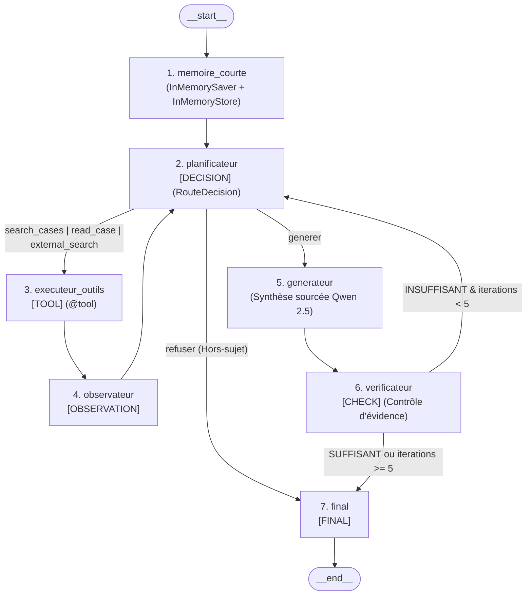

# JurisConsult AI — Agentic RAG pour l'Analyse de Jurisprudence
> Module : Implémentation  de cas d'usages industriels - Université Paris 8
> Réalisé par ANTON NELCON Steve -LIMACHE Adrien


> **Dépôt d'origine :** [https://github.com/AdrienLIMACHE/jurisconsult-agentic-rag](https://github.com/AdrienLIMACHE/jurisconsult-agentic-rag)  
> **Système Agentique Multi-Outils orchestré par LangGraph (`StateGraph`), Recherche Hybride (`BM25` + `ChromaDB`) et LLM Local (`Qwen 2.5 1.5B` via Ollama)**  
> Corpus : Décisions civiles du **Tribunal judiciaire de Paris** (*dataset Hugging Face `antoinejeannot/jurisprudence`*)

---
## Vidéo de Démonstration de la Vidéo :

Lien de la vidéo de démonstration du projet : https://youtu.be/EuvapwFRdoM?si=UbKcT1USTJY4vPRh


## Présentation de l'Architecture

**JurisConsult AI** est une application Full-Stack (**FastAPI + LangGraph + React**) permettant d'analyser les décisions du Tribunal judiciaire de Paris à l'aide d'un **Agent RAG Autonome (Agentic RAG)**.

Contrairement à un pipeline RAG linéaire figé, l'agent est orchestré par un graphe d'états cyclique **LangGraph (`StateGraph`)** composé de **7 noeuds** :
1. **`memoire_courte`** : Gestion de la mémoire conversationnelle court terme (`InMemorySaver` par `thread_id`) et de la mémoire inter-sessions long terme (`InMemoryStore`).
2. **`planificateur` (`[DECISION]`)** : Routage dynamique structuré (`RouteDecision`) choisissant l'outil pertinent ou le passage à la génération.
3. **`executeur_outils` (`[TOOL]`)** : Exécution sécurisée des 3 outils `@tool` :
   - `search_cases(query, k)` : Recherche hybride (**BM25 50 % + ChromaDB 50 %**) dans le corpus local `[CORPUS_TP2]`.
   - `read_case(case_id, focus_query)` : Lecture ciblée d'un arrêt, extraction déterministe de sa **Fiche d'Identité Officielle** (RG, Juge, Greffier, Parties, Avocats, Dépens, Art. 700) et re-ranking structurel des attendus `[CORPUS_TP2]`.
   - `external_search(query)` : Recherche juridique externe (Code civil, Code de procédure civile, Loi Badinter + API MediaWiki FR) balisée `[SOURCE_EXTERNE]`.
4. **`observateur` (`[OBSERVATION]`)** : Analyse et condensation des preuves documentaires collectées.
5. **`generateur`** : Synthèse juridique sourcée via **Qwen 2.5 1.5B** (Ollama) distinguant strictement `[CORPUS_TP2]` et `[SOURCE_EXTERNE]`.
6. **`verificateur` (`[CHECK]`)** : Contrôle de présence d'évidence, de couverture multi-étapes et de cohérence factuelle anti-hallucination (boucle de relance automatique si `INSUFFISANT`, bornée à `MAX_ITERATIONS = 5`).
7. **`final` (`[FINAL]`)** : Validation finale, sauvegarde en mémoire longue et diffusion Server-Sent Events (SSE) vers l'interface React.



---

## Guide d'Installation Complet de A à Z

Suivez ces étapes dans l'ordre pour installer, indexer et lancer le projet sur votre machine (**Windows PowerShell** ou **Linux / macOS**).

---

### Étape 1 — Prérequis Système

Assurez-vous d'avoir installé sur votre machine :
1. **Python 3.10+** ([python.org](https://www.python.org/downloads/))
2. **Node.js 18+** et **npm** ([nodejs.org](https://nodejs.org/))
3. **Git** ([git-scm.com](https://git-scm.com/))
4. **Ollama** ([ollama.com](https://ollama.com/)) pour l'inférence LLM locale

---

### Étape 2 — Cloner le Dépôt GitHub

```bash
git clone https://github.com/AdrienLIMACHE/jurisconsult-agentic-rag.git
cd jurisconsult-agentic-rag
```

---

### Étape 3 — Créer l'Environnement Virtuel Python (`venv`) et Installer les Dépendances

#### Sous Windows (PowerShell) :
```powershell
# 1. Créer l'environnement virtuel
python -m venv venv

# 2. Activer l'environnement virtuel
.\venv\Scripts\Activate.ps1

# 3. Mettre à jour pip et installer toutes les dépendances (FastAPI, LangChain, LangGraph, ChromaDB, PyArrow...)
python -m pip install --upgrade pip
pip install -r requirements.txt
```

#### Sous Linux / macOS :
```bash
python3 -m venv venv
source venv/bin/activate
pip install --upgrade pip
pip install -r requirements.txt
```

---

### Étape 4 — Installer et Télécharger le Modèle LLM Local (`Qwen 2.5 1.5B`) avec Ollama

Assurez-vous que l'application **Ollama** est lancée en arrière-plan, puis téléchargez le modèle `qwen2.5:1.5b` (~986 Mo) :

```bash
ollama pull qwen2.5:1.5b
```

Pour vérifier que le modèle est bien installé :
```bash
ollama list
```

---

### Étape 5 — Télécharger le Dataset Hugging Face et Préparer le Corpus

Le projet utilise le dataset de jurisprudence française **[`antoinejeannot/jurisprudence`](https://huggingface.co/datasets/antoinejeannot/jurisprudence)** (`tribunal_judiciaire.parquet`).

#### 5.1 Télécharger le fichier Parquet source depuis Hugging Face
Exécutez cette commande Python (en une seule ligne) à la racine du projet pour télécharger automatiquement `tribunal_judiciaire.parquet` dans le dossier `antoinejeannot_jurisprudence/` :

```powershell
python -c "from huggingface_hub import hf_hub_download; hf_hub_download(repo_id='antoinejeannot/jurisprudence', filename='tribunal_judiciaire.parquet', repo_type='dataset', local_dir='antoinejeannot_jurisprudence')"
```

#### 5.2 Filtrer et préparer l'échantillon du Tribunal judiciaire de Paris (`data/corpus_sampled.parquet`)
Une fois le fichier téléchargé, lancez le script de préparation des données qui filtre les décisions valides du **Tribunal judiciaire de Paris** et génère `data/corpus_sampled.parquet` :

```powershell
python -m backend.scripts.prepare_data
```

---

### Étape 6 — Construire l'Index Hybride (`ChromaDB` + `BM25`)

Ce script découpe les décisions en chunks (`1 500` caractères, overlap `200`), calcule les embeddings vectoriels via `SentenceTransformers (all-MiniLM-L6-v2)` et construit simultanément :
- La base vectorielle persistante **`chroma_db/`**
- L'index lexical **`data/bm25_index.pkl`**

```powershell
python -m backend.scripts.build_index
```

*(Optionnel : vous pouvez ajuster la taille des lots avec `python -m backend.scripts.build_index --batch-size 10 --cooldown 0.5`).*

---

### Étape 7 — Lancer le Serveur Backend FastAPI (Terminal 1)

Toujours avec votre environnement virtuel `venv` activé à la racine du projet :

```powershell
uvicorn backend.main:app --host 0.0.0.0 --port 8000
```

- **API REST** : `http://localhost:8000`
- **Documentation Swagger interactive** : `http://localhost:8000/docs`
- **Vérification de santé (`/api/health`)** : `http://localhost:8000/api/health`
- **Graphe Mermaid de l'agent (`/api/agent/graph`)** : `http://localhost:8000/api/agent/graph`

---

### Étape 8 — Installer et Lancer le Frontend React (Terminal 2)

Ouvrez un **second terminal**, placez-vous dans le dossier `frontend/`, installez les paquets Node.js et démarrez le serveur de développement Vite :

```powershell
cd frontend
npm install
npm run dev
```

Ouvrez ensuite votre navigateur sur **`http://localhost:5173`**.

---

## Structure du Projet

```text
jurisconsult-agentic-rag/
├── backend/
│   ├── api/
│   │   └── routes.py                 # Endpoints REST (/api/chat, /api/agent/stream SSE, /api/agent/graph)
│   ├── scripts/
│   │   ├── prepare_data.py           # Filtrage et création de data/corpus_sampled.parquet
│   │   └── build_index.py            # Construction de l'index hybride ChromaDB + BM25
│   ├── services/
│   │   ├── agent_service.py          # StateGraph LangGraph (7 noeuds, InMemorySaver, InMemoryStore, CHECK)
│   │   ├── tools_service.py          # 3 outils @tool (search_cases, read_case, external_search)
│   │   ├── langchain_service.py      # Moteur RAG Hybride (BM25 + ChromaDB + Reranking structurel)
│   │   ├── prompt_service.py         # Extracteur déterministe de Fiche d'Identité et prompts QA
│   │   ├── data_service.py           # Lecture Parquet à la demande (Zero-RAM Overhead)
│   │   └── cache_service.py          # Cache JSON persistant des synthèses juridiques
│   ├── config.py                     # Configuration centralisée (Qwen 2.5 1.5B, constantes LangGraph)
│   ├── schemas.py                    # Schémas Pydantic (AgentStep, AgentMetrics, ChatResponse)
│   └── main.py                       # Point d'entrée FastAPI et CORS
├── frontend/
│   ├── src/
│   │   ├── components/
│   │   │   ├── AgentTracePanel.jsx   # Visualisation temps réel des étapes LangGraph et diagramme Mermaid
│   │   │   ├── CaseReaderModal.jsx   # Lecteur de jugement, surlignage des sources et export Audit
│   │   │   ├── CaseGrid.jsx          # Grille de navigation des décisions
│   │   │   ├── SearchBar.jsx         # Barre de recherche hybride / dense / BM25
│   │   │   └── Navbar.jsx            # Barre de navigation
│   │   ├── services/
│   │   │   └── api.js                # Client HTTP REST et Server-Sent Events (SSE)
│   │   ├── App.jsx                   # Composant racine React
│   │   └── main.jsx                  # Point d'entrée React
│   ├── package.json
│   └── vite.config.js
├── data/
│   └── summaries_cache.json          # Cache pré-calculé des résumés juridiques
└── requirements.txt                  # Dépendances Python du projet
```
